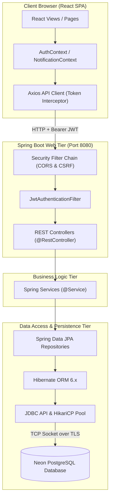
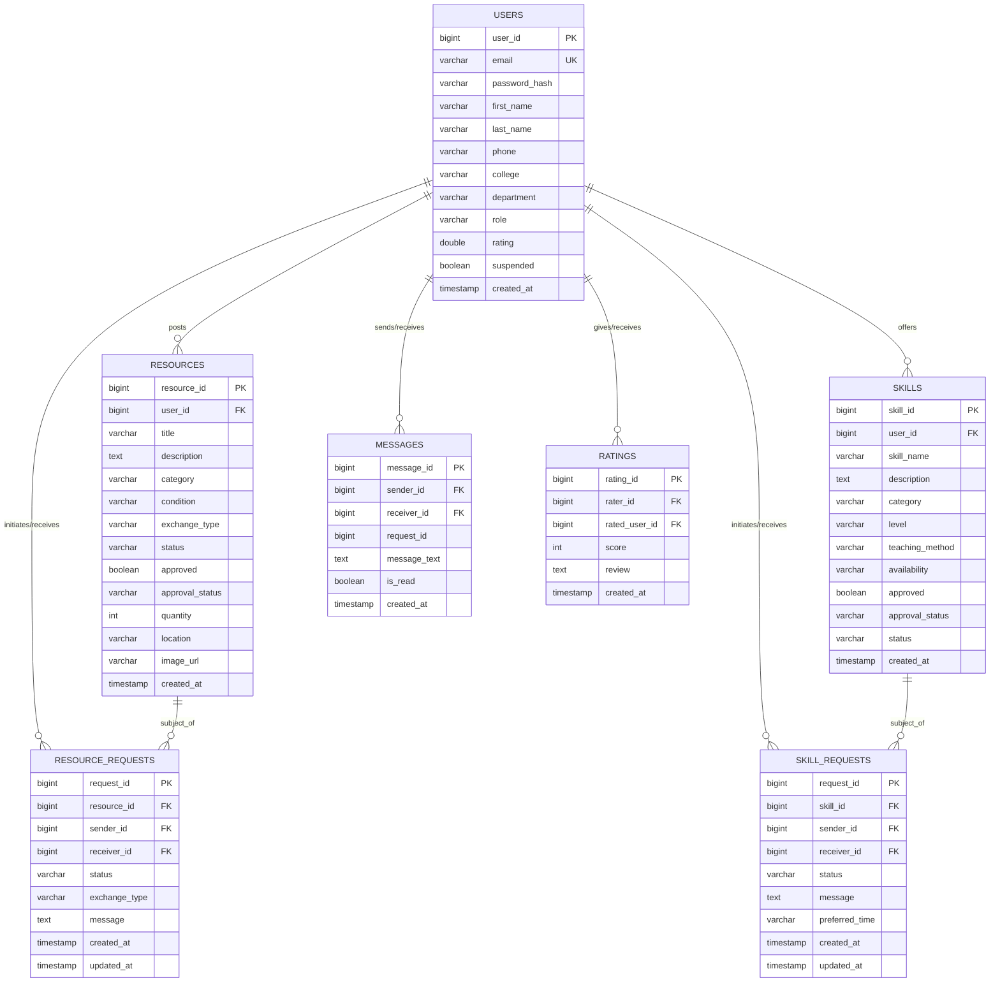

# EduCycle — Complete System Structure & Comprehensive Backend Architecture Guide

> **Project Name:** EduCycle (Collaborative Academic Resource & Skill Exchange Platform)  
> **Tech Stack:** Spring Boot 3.2.3 (Java 17), PostgreSQL (Neon Cloud) / H2, React 18, Bootstrap 5, Firebase Realtime Database  
> **Target Audience:** Developers, Technical Evaluators, Project Reviewers  

---

## Table of Contents
1. [High-Level System Overview & Request Flow](#1-high-level-system-overview--request-flow)
2. [Complete Project Directory Structure](#2-complete-project-directory-structure)
   - [2.1 Frontend Structure](#21-frontend-structure)
   - [2.2 Backend Structure](#22-backend-structure)
3. [Frontend Architecture & Workflow](#3-frontend-architecture--workflow)
   - [3.1 Technology Stack & Design System](#31-technology-stack--design-system)
   - [3.2 State Management & Context Providers](#32-state-management--context-providers)
   - [3.3 API Client & Token Interceptors](#33-api-client--token-interceptors)
   - [3.4 Real-time Communication (Firebase & REST)](#34-real-time-communication-firebase--rest)
4. [Deep-Dive Backend Architecture](#4-deep-dive-backend-architecture)
   - [4.1 Layered Architecture Pattern](#41-layered-architecture-pattern)
   - [4.2 Security & Authentication Lifecycle (JWT & BCrypt)](#42-security--authentication-lifecycle-jwt--bcrypt)
   - [4.3 In-Depth JDBC & Persistence Layer](#43-in-depth-jdbc--persistence-layer)
     - [What is JDBC and How it Operates](#what-is-jdbc-and-how-it-operates)
     - [Connection Pooling (HikariCP) & Neon PostgreSQL Driver](#connection-pooling-hikaricp--neon-postgresql-driver)
     - [Hibernate ORM & Spring Data JPA over JDBC](#hibernate-orm--spring-data-jpa-over-jdbc)
     - [Entity-Relationship Mapping & SQL Translation](#entity-relationship-mapping--sql-translation)
     - [Transaction Management & ACID Semantics](#transaction-management--acid-semantics)
     - [Database Seeding (DataInitializer)](#database-seeding-datainitializer)
5. [Complete Database Schema (Tables & Relationships)](#5-complete-database-schema-tables--relationships)
6. [Comprehensive REST API Reference](#6-comprehensive-rest-api-reference)
   - [6.1 Authentication API (`/api/auth`)](#61-authentication-api-apiauth)
   - [6.2 User Profile API (`/api/users`)](#62-user-profile-api-apiusers)
   - [6.3 Academic Resources API (`/api/resources`)](#63-academic-resources-api-apiresources)
   - [6.4 Skill Exchange API (`/api/skills`)](#64-skill-exchange-api-apiskills)
   - [6.5 Exchange Requests API (`/api`)](#65-exchange-requests-api-api)
   - [6.6 Chat & Messages API (`/api/messages`)](#66-chat--messages-api-apimessages)
   - [6.7 Peer Ratings & Reviews API (`/api/ratings`)](#67-peer-ratings--reviews-api-apiratings)
   - [6.8 Administration & Moderation API (`/api/admin`)](#68-administration--moderation-api-apiadmin)
   - [6.9 Public Platform Statistics API (`/api/stats`)](#69-public-platform-statistics-api-apistats)
   - [6.10 Health & Monitoring API (`/health`, `/api/health`)](#610-health--monitoring-api-health-apihealth)
7. [End-to-End Request Trace (Trace of a Single API Request)](#7-end-to-end-request-trace-trace-of-a-single-api-request)

---

## 1. High-Level System Overview & Request Flow

EduCycle is built on a decoupled client-server architecture:
1. **Client Tier (Frontend):** Single Page Application (SPA) built using React 18, React Router v6, and Axios.
2. **Server Tier (Backend):** Enterprise REST API service built with Java 17 and Spring Boot 3.2.3.
3. **Database Tier (Persistence):** PostgreSQL hosted on Neon Serverless Cloud (or H2 for local embedded testing), managed via Spring Data JPA, Hibernate, and JDBC.
4. **Real-Time Tier (Auxiliary):** Firebase Realtime Database for instant push updates and user presence.



---

## 2. Complete Project Directory Structure

```
javaproject/
├── pom.xml                               # Root Maven project configuration
├── database.rules.json                   # Firebase Realtime Database security rules
├── README.md                             # Repository overview
├── EDUCYCLE_COMPLETE.md                  # Project submission documentation
├── EDUCYCLE_SYSTEM_ARCHITECTURE_AND_BACKEND_GUIDE.md # This architecture guide
├── backend/                              # Spring Boot 3.2.3 Microservice
│   ├── pom.xml                           # Maven dependencies (JPA, Security, JJWT, Postgres)
│   ├── Dockerfile                        # Multi-stage Docker deployment for cloud (Render)
│   ├── .dockerignore                     # Docker build exclusion rules
│   └── src/
│       ├── main/
│       │   ├── java/com/educycle/
│       │   │   ├── EducycleApplication.java     # Spring Boot Entry Point (@SpringBootApplication)
│       │   │   ├── config/                      # Web & Application Configurations
│       │   │   │   ├── CorsConfig.java          # Cross-Origin Resource Sharing settings
│       │   │   │   └── DataInitializer.java     # Database seeding on startup (CommandLineRunner)
│       │   │   ├── controller/                  # REST API Controllers (HTTP Request Handlers)
│       │   │   │   ├── AdminController.java     # Admin actions (moderation, stats, user ban)
│       │   │   │   ├── AuthController.java      # User registration & JWT authentication
│       │   │   │   ├── HealthController.java    # Uptime & container health monitoring
│       │   │   │   ├── MessageController.java   # Internal request chat messaging
│       │   │   │   ├── RatingController.java    # User review and rating submission
│       │   │   │   ├── RequestController.java   # Skill & Resource exchange workflows
│       │   │   │   ├── ResourceController.java  # CRUD & search for physical resources
│       │   │   │   ├── SkillController.java     # CRUD & search for student skill offerings
│       │   │   │   ├── StatsController.java     # Public analytics & hero counter data
│       │   │   │   └── UserController.java      # User profile inspection and update
│       │   │   ├── dto/                         # Data Transfer Objects (Request/Response Payloads)
│       │   │   │   ├── AuthRequest.java         # Login credentials payload
│       │   │   │   ├── AuthResponse.java        # Authentication token & user info response
│       │   │   │   ├── RegisterRequest.java     # Account registration payload
│       │   │   │   ├── RequestDTO.java          # Base request transport
│       │   │   │   ├── RequestDisplayDTO.java   # Enriched UI representation for exchange items
│       │   │   │   ├── ResourceDTO.java         # Resource representation
│       │   │   │   ├── ResourceExchangeRequestDTO.java # Payload for requesting a resource
│       │   │   │   ├── ResourceRequestDTO.java  # Payload for creating a resource listing
│       │   │   │   ├── SkillDTO.java            # Skill representation
│       │   │   │   ├── SkillExchangeRequestDTO.java    # Payload for requesting a skill session
│       │   │   │   ├── SkillRequestDTO.java     # Payload for creating a skill listing
│       │   │   │   ├── SuspendUserRequest.java  # Admin user suspension parameters
│       │   │   │   └── UserDTO.java             # User account data transfer object
│       │   │   ├── entity/                      # JPA Database Entities (Table Mappings)
│       │   │   │   ├── Category.java            # Resource & skill categories
│       │   │   │   ├── Message.java             # Chat message entity
│       │   │   │   ├── Notification.java        # System notification entity
│       │   │   │   ├── Rating.java              # User rating & review entity
│       │   │   │   ├── Resource.java            # Shared academic resource (books, kits, etc.)
│       │   │   │   ├── ResourceRequest.java     # Borrow/Donate/Exchange transaction
│       │   │   │   ├── Skill.java               # Skill offered for peer teaching
│       │   │   │   ├── SkillRequest.java        # Skill learning session transaction
│       │   │   │   ├── User.java                # Registered student entity
│       │   │   │   └── enums/                   # Business domain enumerations
│       │   │   │       ├── ExchangeType.java    # DONATE, LEND, EXCHANGE
│       │   │   │       ├── NotificationType.java# REQUEST, STATUS_UPDATE, MESSAGE, RATING
│       │   │   │       ├── RequestStatus.java   # PENDING, ACCEPTED, REJECTED, COMPLETED, CANCELLED
│       │   │   │       ├── ResourceCondition.java # NEW, LIKE_NEW, GOOD, FAIR
│       │   │   │       ├── ResourceStatus.java  # AVAILABLE, RESERVED, EXCHANGED
│       │   │   │       ├── SkillLevel.java      # BEGINNER, INTERMEDIATE, ADVANCED, EXPERT
│       │   │   │       ├── SkillStatus.java     # ACTIVE, INACTIVE
│       │   │   │       └── TeachingMethod.java  # ONLINE, IN_PERSON, BOTH
│       │   │   ├── exception/                   # Error handling & custom exceptions
│       │   │   │   ├── AccountSuspendedException.java # Thrown when a suspended user logs in
│       │   │   │   ├── GlobalExceptionHandler.java    # @ControllerAdvice centralized exception handler
│       │   │   │   ├── ResourceNotFoundException.java # Thrown when an ID does not exist in DB
│       │   │   │   └── UnauthorizedException.java     # Thrown when operation is unpermitted
│       │   │   ├── repository/                  # Spring Data JPA Data Access Interfaces
│       │   │   │   ├── CategoryRepository.java
│       │   │   │   ├── MessageRepository.java
│       │   │   │   ├── NotificationRepository.java
│       │   │   │   ├── RatingRepository.java
│       │   │   │   ├── ResourceRepository.java
│       │   │   │   ├── ResourceRequestRepository.java
│       │   │   │   ├── SkillRepository.java
│       │   │   │   ├── SkillRequestRepository.java
│       │   │   │   └── UserRepository.java
│       │   │   ├── security/                    # Spring Security & JWT components
│       │   │   │   ├── JwtAuthenticationFilter.java  # Request filter for Authorization header
│       │   │   │   ├── JwtTokenProvider.java         # Token generation, decoding & validation
│       │   │   │   └── SecurityConfig.java           # FilterChain, CORS, CSRF, BCrypt configuration
│       │   │   ├── service/                     # Business Logic Implementation
│       │   │   │   ├── AuthService.java         # Auth logic & credential verification
│       │   │   │   ├── FirebaseService.java     # Firebase Admin SDK user synchronization
│       │   │   │   ├── MessageService.java      # Internal message persistence
│       │   │   │   ├── NotificationService.java # User notification dispatch
│       │   │   │   ├── RatingService.java       # User feedback calculation
│       │   │   │   ├── RequestService.java      # Exchange state-machine transitions
│       │   │   │   ├── ResourceService.java     # Resource filtering, status and approval
│       │   │   │   ├── SkillService.java        # Skill filtering, status and approval
│       │   │   │   └── UserService.java         # User management logic
│       │   │   └── util/
│       │   │       └── ValidationUtil.java      # Common validation routines
│       │   └── resources/
│       │       └── application.properties       # DB URL, credentials, JPA, JWT parameters
│       └── test/java/com/educycle/
│           └── controller/
│               └── HealthControllerTest.java    # Automated unit & integration tests
│
└── frontend/                             # React 18 SPA Client
    ├── package.json                      # NPM dependencies & build scripts
    ├── public/
    │   ├── index.html                    # Base HTML page template
    │   ├── favicon.ico                   # Application icon
    │   ├── manifest.json                 # Web app metadata
    │   └── robots.txt                    # Search crawler rules
    └── src/
        ├── App.js                        # App Root, Route table & ProtectedRoute guards
        ├── index.js                      # React DOM render entry point
        ├── firebase.js                   # Client-side Firebase SDK configuration
        ├── css/
        │   └── index.css                 # Custom glassmorphism, responsive styles & gradients
        ├── components/                   # Modular Reusable React UI Elements
        │   ├── AnimatedPage.js           # Framer-motion page entry transitions
        │   ├── FlowingBackground.js      # Animated background ambient gradient effect
        │   ├── Footer.js                 # Global footer with university links
        │   ├── MessageBox.js             # Chat display bubble component
        │   ├── MobileBottomNav.js        # Mobile responsive bottom tab bar
        │   ├── Navbar.js                 # Header navigation bar with notifications & auth state
        │   ├── RequestModal.js           # Interactive modal for initiating exchanges
        │   ├── ResourceCard.js           # Card for books/equipment with condition tags
        │   └── SkillCard.js              # Card for skills with level badges & author details
        ├── context/                      # React Context Global State
        │   ├── AuthContext.js            # User session, JWT tokens, login/logout handlers
        │   └── NotificationContext.js    # Unread counter and notification alerts
        ├── pages/                        # Main Route Page Views
        │   ├── AdminPanel.js             # Admin dashboard: approvals, stats, user bans
        │   ├── Dashboard.js              # User control panel: my items, incoming/sent requests
        │   ├── Home.js                   # Hero landing page, statistics, testimonials
        │   ├── Login.js                  # User sign-in form
        │   ├── Messages.js               # Chat messaging interface between exchange partners
        │   ├── NotFound.js               # 404 Error page
        │   ├── Profile.js                # User public & private profile management
        │   ├── Register.js               # Student sign-up form
        │   ├── Resources.js              # Resource marketplace with search, sort & filters
        │   └── Skills.js                 # Skill directory with category & level filters
        └── services/                     # Network & Data Services
            ├── api.js                    # Central Axios instance with JWT interceptors
            ├── authService.js            # Auth API calls (login, register, session)
            ├── firebaseChatService.js    # Firebase Realtime Database direct chat listeners
            ├── miscServices.js           # Statistics, health checks, and notifications
            ├── requestService.js         # Exchange request submission & status updates
            ├── resourceService.js        # Resource fetching, creation & deletion
            ├── skillService.js           # Skill fetching, creation & deletion
            └── userService.js            # User profile update endpoints
```

---

## 3. Frontend Architecture & Workflow

### 3.1 Technology Stack & Design System
- **Core Framework:** React 18 (Functional Components with Hooks: `useState`, `useEffect`, `useContext`, `useCallback`, `useMemo`).
- **Routing:** `react-router-dom` v6 with declarative `<Routes>` and nested `<ProtectedRoute>` wrappers that redirect unauthenticated visitors to `/login`.
- **Styling:** Bootstrap 5.3 + Custom CSS3 variables in `src/css/index.css`. The aesthetic utilizes:
  - Glassmorphic panels (`backdrop-filter: blur(12px); background: rgba(255, 255, 255, 0.85);`)
  - Floating ambient animated blobs (`FlowingBackground.js`)
  - Consistent color palette: Primary Teal (`#0d9488`), Indigo accent (`#6366f1`), Emerald success (`#10b981`), Amber warning (`#f59e0b`).

### 3.2 State Management & Context Providers
Global states are managed through lightweight React Contexts:
1. **`AuthContext.js`:**
   - Stores `user` object and `token` string in both React state and browser `localStorage`.
   - Exposes `login(credentials)`, `register(data)`, `logout()`, `updateUser(data)`.
   - Decodes JWT expiry on boot to automatically log out expired sessions.
2. **`NotificationContext.js`:**
   - Polls or listens for incoming exchange requests and unread messages.
   - Updates the notification badge in `Navbar.js`.

### 3.3 API Client & Token Interceptors (`src/services/api.js`)
All communication with the Spring Boot backend flows through a configured Axios instance:
- **Base URL Resolution:** Automatically toggles between local backend (`http://localhost:8080/api`) and production cloud URL (`https://javaproject-educycle.onrender.com/api`).
- **Request Interceptor:**
  ```javascript
  API.interceptors.request.use((config) => {
    const token = localStorage.getItem('token');
    if (token) {
      config.headers.Authorization = `Bearer ${token}`;
    }
    return config;
  });
  ```
- **Response Interceptor:** Intercepts `401 Unauthorized` responses, clears invalid tokens from storage, and redirects the browser to `/login`.

### 3.4 Real-time Communication (Firebase & REST)
- While transactions and entities are stored reliably in the relational PostgreSQL database via REST, real-time messaging utilizes **Firebase Realtime Database** (`firebaseChatService.js`) for low-latency live typing and message delivery.
- REST fallback endpoints (`/api/messages`) persist messages directly into PostgreSQL for auditing and historical retrieval.

---

## 4. Deep-Dive Backend Architecture

### 4.1 Layered Architecture Pattern
The backend adheres strictly to the **Enterprise Separation of Concerns** design pattern:

```
[ HTTP Request ]
       │
       ▼
┌────────────────────────────────────────────────────────┐
│ 1. Controller Layer (@RestController)                  │
│    - Accepts HTTP requests, parses JSON into DTOs      │
│    - Validates request payload using Jakarta Bean      │
│      Validation (@Valid, @NotNull, @NotBlank)          │
│    - Delegates to Service layer & returns ResponseEntity│
└────────────────────────────────────────────────────────┘
       │
       ▼
┌────────────────────────────────────────────────────────┐
│ 2. Service Layer (@Service)                            │
│    - Encapsulates business logic, rules & workflows    │
│    - Checks entity ownership & permissions             │
│    - Coordinates state transitions (PENDING -> ACCEPTED)│
│    - Manages database transaction boundaries           │
└────────────────────────────────────────────────────────┘
       │
       ▼
┌────────────────────────────────────────────────────────┐
│ 3. Repository Layer (@Repository / JpaRepository)      │
│    - Data Access Object (DAO) abstraction              │
│    - Dynamic query derivation (findByEmail, etc.)      │
│    - Translates calls into JPA/Hibernate operations    │
└────────────────────────────────────────────────────────┘
       │
       ▼
┌────────────────────────────────────────────────────────┐
│ 4. ORM & JDBC Layer (Hibernate 6 + HikariCP + JDBC)    │
│    - Converts Entity graphs to native SQL queries      │
│    - Prepares JDBC PreparedStatement with parameters   │
│    - Obtains pooled connections from HikariCP          │
│    - Executes SQL over network socket to PostgreSQL    │
└────────────────────────────────────────────────────────┘
```

---

### 4.2 Security & Authentication Lifecycle (JWT & BCrypt)

1. **Password Hashing:**
   - Raw user passwords are never stored in plaintext. `SecurityConfig.java` defines a `@Bean PasswordEncoder` using `BCryptPasswordEncoder` with a work factor of 10.
2. **Stateless JWT Generation:**
   - When a user logs in via `POST /api/auth/login`, `AuthService` verifies the BCrypt hash.
   - If valid, `JwtTokenProvider.java` constructs a JSON Web Token signed with HMAC-SHA256 (`Keys.hmacShaKeyFor`) containing:
     - `sub`: User email address
     - `iat`: Issue timestamp
     - `exp`: Expiration timestamp (default: 24 hours / 86,400,000 ms)
3. **Filter Pipeline:**
   - Every incoming HTTP request passes through `JwtAuthenticationFilter`:
     - Reads `Authorization: Bearer <token>` header.
     - Validates token signature and expiration.
     - Resolves user email and populates the `SecurityContextHolder`.
     - In case of invalid or expired tokens, rejects execution with HTTP 401.

---

### 4.3 In-Depth JDBC & Persistence Layer

The persistence tier in EduCycle utilizes a multi-layered stack combining **Spring Data JPA**, **Hibernate ORM**, and the underlying **Java Database Connectivity (JDBC)** driver.

#### What is JDBC and How it Operates
**JDBC (Java Database Connectivity)** is the standard Java API (part of `java.sql` and `javax.sql`) for connecting Java applications to relational database management systems (RDBMS).

```
Java Code (Spring Data / Hibernate)
          │
          ▼
   JDBC API (java.sql)
  [Connection, Statement, PreparedStatement, ResultSet]
          │
          ▼
   PostgreSQL JDBC Driver (org.postgresql.Driver)
          │
          ▼
   HikariCP Connection Pool (javax.sql.DataSource)
          │ (TCP/IP SSL Connection)
          ▼
   Neon Cloud PostgreSQL Database
```

Under the hood, every interaction with PostgreSQL executes through four core JDBC phases:
1. **Driver Loading & Connection Acquisition:**
   - The PostgreSQL JDBC Driver (`org.postgresql.Driver`) is loaded into the JVM.
   - The driver establishes a secure TCP/IP SSL socket connection to `ep-divine-boat-azx66ajr-pooler.c-3.ap-southeast-1.aws.neon.tech:5432`.
2. **SQL Compilation & Parameter Binding (`PreparedStatement`):**
   - Instead of concatenating raw strings (which causes SQL Injection vulnerabilities), JDBC uses parameterized statements:
     ```java
     // Conceptual JDBC code executed behind Spring Data JPA:
     String sql = "SELECT * FROM users WHERE email = ?";
     PreparedStatement stmt = connection.prepareStatement(sql);
     stmt.setString(1, "student@college.edu");
     ```
3. **Execution & Network Transmission:**
   - The compiled query and binary parameters are transmitted across the network to Neon PostgreSQL.
4. **Result Set Mapping (`ResultSet`):**
   - The database engine executes the query and returns binary rows.
   - The JDBC driver parses the stream into a `ResultSet`:
     ```java
     ResultSet rs = stmt.executeQuery();
     while (rs.next()) {
         Long id = rs.getLong("user_id");
         String firstName = rs.getString("first_name");
         // Map to Java Object
     }
     ```

#### Connection Pooling (HikariCP) & Neon PostgreSQL Driver
Creating a new physical database connection involves a heavy TCP handshake, TLS encryption negotiation, and PostgreSQL process authentication (taking 100–300ms per connection).

To eliminate this latency, EduCycle uses **HikariCP** (Spring Boot's default high-performance connection pool):
- A pool of active, authenticated database connections is maintained in memory.
- When a Spring service calls a repository method, HikariCP leases an existing connection from the pool in microseconds.
- Once the database transaction finishes, the connection is returned to the pool rather than closed.
- Configured in `application.properties`:
  ```properties
  spring.datasource.url=jdbc:postgresql://ep-divine-boat-azx66ajr-pooler.c-3.ap-southeast-1.aws.neon.tech/neondb?sslmode=require
  spring.datasource.driverClassName=org.postgresql.Driver
  spring.datasource.username=${SPRING_DATASOURCE_USERNAME:neondb_owner}
  spring.datasource.password=${SPRING_DATASOURCE_PASSWORD:npg_8dmxtXON4bQJ}
  ```

#### Hibernate ORM & Spring Data JPA over JDBC
Rather than writing hundreds of lines of boilerplate JDBC code (`try { conn.close(); } catch...`), EduCycle uses **Spring Data JPA** with **Hibernate 6** as the Object-Relational Mapping (ORM) engine:

| Layer | Responsibility in EduCycle |
|---|---|
| **Spring Data JPA** | Provides ready-to-use repository interfaces (`JpaRepository<User, Long>`) with auto-derived query methods such as `findByEmail()`, `findByCategoryAndLevel()`, `countByApproved()`. |
| **Hibernate ORM** | Inspects `@Entity` annotations on Java classes, generates optimized ANSI SQL dialect for PostgreSQL, manages object identity and dirty-checking (automatic UPDATE detection). |
| **JDBC Driver** | Transmits the generated SQL and receives raw tabular data from PostgreSQL over the network. |

#### Entity-Relationship Mapping & SQL Translation

1. **Primary Key Strategy (`GenerationType.IDENTITY`):**
   ```java
   @Id
   @GeneratedValue(strategy = GenerationType.IDENTITY)
   @Column(name = "resource_id")
   private Long resourceId;
   ```
   *JDBC Translation:* Maps to PostgreSQL's native `BIGSERIAL` / `GENERATED ALWAYS AS IDENTITY` sequence.

2. **Many-to-One Relationships (`@ManyToOne` & `@JoinColumn`):**
   ```java
   @ManyToOne(fetch = FetchType.EAGER)
   @JoinColumn(name = "user_id", nullable = false)
   private User user;
   ```
   *JDBC Translation:* Creates a Foreign Key constraint `FOREIGN KEY (user_id) REFERENCES users(user_id)`. When querying a Resource, Hibernate automatically constructs an inner/left join:
   ```sql
   SELECT r.*, u.first_name, u.email FROM resources r 
   LEFT JOIN users u ON r.user_id = u.user_id WHERE r.resource_id = ?
   ```

3. **Enumerated Columns (`@Enumerated(EnumType.STRING)`):**
   ```java
   @Enumerated(EnumType.STRING)
   @Column(name = "exchange_type", nullable = false)
   private ExchangeType exchangeType; // DONATE, LEND, EXCHANGE
   ```
   *JDBC Translation:* Stored as `VARCHAR` in the database, ensuring clean human-readable values and preventing numerical enum re-ordering bugs.

4. **Automatic Audit Timestamps (`@CreationTimestamp`, `@UpdateTimestamp`):**
   ```java
   @CreationTimestamp
   @Column(name = "created_at", updatable = false)
   private LocalDateTime createdAt;
   ```
   *JDBC Translation:* Automatically populated with `CURRENT_TIMESTAMP` during INSERT and UPDATE operations without manual setter calls.

#### Transaction Management & ACID Semantics
All write operations in services are bounded by Spring's `@Transactional` context:
- **Atomicity:** When accepting an exchange request, updating the request status to `ACCEPTED` and marking the resource status to `RESERVED` happen inside a single database transaction. If any step fails, the JDBC driver issues a `ROLLBACK`, leaving the database consistent.
- **Consistency:** Database schema constraints (unique email, not-null foreign keys) are enforced before commits.
- **Isolation:** Uses read-committed isolation to prevent dirty reads across concurrent user requests.
- **Durability:** Neon PostgreSQL writes all committed transactions to Write-Ahead Logs (WAL) before acknowledging success.

#### Database Seeding (`DataInitializer.java`)
On startup, `DataInitializer` implements Spring's `CommandLineRunner`:
- Checks if default categories (e.g., Computer Science, Electrical Engineering, Mathematics) exist via `CategoryRepository.count()`.
- If empty, creates default academic categories and seeds initial admin user accounts using standard repository `saveAll()` methods over JDBC.

---

## 5. Complete Database Schema (Tables & Relationships)



---

## 6. Comprehensive REST API Reference

All protected endpoints require the HTTP Header:
`Authorization: Bearer <JWT_TOKEN>`

### 6.1 Authentication API (`/api/auth`)
Handled by: `AuthController.java`

| HTTP Method | Endpoint | Access | Request Body (DTO) | Success Response | Description |
|---|---|---|---|---|---|
| `POST` | `/api/auth/register` | Public | `RegisterRequest` `{ email, password, firstName, lastName, phone, college, department }` | `200 OK` + `AuthResponse` `{ token, user }` | Validates input, encrypts password with BCrypt, stores user in DB, and returns a JWT token. |
| `POST` | `/api/auth/login` | Public | `AuthRequest` `{ email, password }` | `200 OK` + `AuthResponse` `{ token, user }` | Validates credentials against DB hash, verifies user is not suspended, and issues JWT. |

---

### 6.2 User Profile API (`/api/users`)
Handled by: `UserController.java`

| HTTP Method | Endpoint | Access | Request Parameters / Body | Success Response | Description |
|---|---|---|---|---|---|
| `GET` | `/api/users` | Authenticated | None | `200 OK` + `List<User>` | Fetches list of registered student profiles. |
| `GET` | `/api/users/{id}` | Authenticated | Path variable: `id` (Long) | `200 OK` + `User` | Returns complete profile details of a specific student. Returns `404` if not found. |
| `PUT` | `/api/users/{id}` | Authenticated | Path: `id`, Body: `User` fields to update | `200 OK` + Updated `User` | Updates personal details (phone, college, department, bio, avatarUrl). |

---

### 6.3 Academic Resources API (`/api/resources`)
Handled by: `ResourceController.java`

| HTTP Method | Endpoint | Access | Request Parameters / Body | Success Response | Description |
|---|---|---|---|---|---|
| `GET` | `/api/resources` | Public / Auth | Optional query: `?userId=1` | `200 OK` + `List<Resource>` | Returns all approved active resources. If `userId` is passed, filters by that user's postings. |
| `GET` | `/api/resources/{id}` | Public / Auth | Path variable: `id` | `200 OK` + `Resource` | Returns full resource details including owner details and pickup location. |
| `POST` | `/api/resources` | Authenticated | `ResourceRequestDTO` `{ title, description, category, condition, exchangeType, quantity, location, imageUrl, userId }` | `200 OK` + Created `Resource` | Creates a new academic resource listing (defaults to pending moderation). |
| `DELETE` | `/api/resources/{id}` | Authenticated | Path variable: `id` | `204 No Content` | Removes a resource listing from the system. |

---

### 6.4 Skill Exchange API (`/api/skills`)
Handled by: `SkillController.java`

| HTTP Method | Endpoint | Access | Request Parameters / Body | Success Response | Description |
|---|---|---|---|---|---|
| `GET` | `/api/skills` | Public / Auth | Optional query: `?userId=1` | `200 OK` + `List<Skill>` | Returns active skill listings. If `userId` is passed, returns skills offered by that user. |
| `GET` | `/api/skills/{id}` | Public / Auth | Path variable: `id` | `200 OK` + `Skill` | Retrieves detailed information about a specific peer tutoring listing. |
| `POST` | `/api/skills` | Authenticated | `SkillRequestDTO` `{ skillName, description, category, level, teachingMethod, availability, userId }` | `200 OK` + Created `Skill` | Posts a new student skill offering into the directory. |
| `DELETE` | `/api/skills/{id}` | Authenticated | Path variable: `id` | `204 No Content` | Deletes a skill offering. |

---

### 6.5 Exchange Requests API (`/api`)
Handled by: `RequestController.java`

| HTTP Method | Endpoint | Access | Request Body / Parameters | Success Response | Description |
|---|---|---|---|---|---|
| `POST` | `/api/resource-requests` | Authenticated | `ResourceExchangeRequestDTO` `{ resourceId, senderId, receiverId, exchangeType, message }` | `200 OK` + `ResourceRequest` | Submits a request to borrow, receive, or trade an academic resource item. |
| `GET` | `/api/resource-requests/{id}` | Authenticated | Path variable: `id` | `200 OK` + `ResourceRequest` | Gets details and current state of a resource request. |
| `PUT` | `/api/resource-requests/{id}` | Authenticated | Body: `{ "status": "ACCEPTED" }` | `200 OK` + Updated `ResourceRequest` | Updates request status (`ACCEPTED`, `REJECTED`, `COMPLETED`, `CANCELLED`). |
| `DELETE` | `/api/resource-requests/{id}` | Authenticated | Path variable: `id` | `204 No Content` | Cancels a resource exchange request. |
| `POST` | `/api/skill-requests` | Authenticated | `SkillExchangeRequestDTO` `{ skillId, senderId, receiverId, message, preferredTime }` | `200 OK` + `SkillRequest` | Requests a peer tutoring or skill mentoring exchange. |
| `GET` | `/api/skill-requests/{id}` | Authenticated | Path variable: `id` | `200 OK` + `SkillRequest` | Retrieves details of a specific skill mentoring request. |
| `PUT` | `/api/skill-requests/{id}` | Authenticated | Body: `{ "status": "ACCEPTED" }` | `200 OK` + Updated `SkillRequest` | Accepts, declines, or finishes a skill exchange. |
| `DELETE` | `/api/skill-requests/{id}` | Authenticated | Path variable: `id` | `204 No Content` | Cancels a pending skill mentoring request. |
| `GET` | `/api/my-requests` | Authenticated | Query: `?userId={id}` | `200 OK` + `List<RequestDisplayDTO>` | Fetches all incoming requests directed to the logged-in user. |
| `GET` | `/api/my-sent-requests` | Authenticated | Query: `?userId={id}` | `200 OK` + `List<RequestDisplayDTO>` | Fetches all outgoing requests initiated by the logged-in user. |

---

### 6.6 Chat & Messages API (`/api/messages`)
Handled by: `MessageController.java`

| HTTP Method | Endpoint | Access | Parameters / Body | Success Response | Description |
|---|---|---|---|---|---|
| `GET` | `/api/messages/{requestId}` | Authenticated | Path: `requestId` (Long) | `200 OK` + `List<Message>` | Retrieves chronological message conversation for a specific exchange request. |
| `GET` | `/api/messages/{user1Id}/{user2Id}` | Authenticated | Path: `user1Id`, `user2Id` | `200 OK` + `List<Message>` | Retrieves direct message history between two specific students. |
| `POST` | `/api/messages` | Authenticated | Body: `{ requestId, senderId, type, messageText }` | `200 OK` + `Message` | Persists a new chat message to PostgreSQL database. |

---

### 6.7 Peer Ratings & Reviews API (`/api/ratings`)
Handled by: `RatingController.java`

| HTTP Method | Endpoint | Access | Parameters / Body | Success Response | Description |
|---|---|---|---|---|---|
| `GET` | `/api/ratings/user/{userId}` | Public / Auth | Path variable: `userId` | `200 OK` + `List<Rating>` | Retrieves all star reviews and written feedback received by a student. |
| `POST` | `/api/ratings` | Authenticated | Body: `Rating` `{ score (1-5), review, rater, ratedUser }` | `200 OK` + Created `Rating` | Submits a peer evaluation after an exchange is completed and recalculates average rating. |

---

### 6.8 Administration & Moderation API (`/api/admin`)
Handled by: `AdminController.java`

| HTTP Method | Endpoint | Access | Parameters / Body | Success Response | Description |
|---|---|---|---|---|---|
| `GET` | `/api/admin/stats` | Admin Only | None | `200 OK` + `{ totalUsers, totalResources, pendingResources, approvedResources, totalSkills, pendingSkills, approvedSkills }` | Returns comprehensive administrative analytics. |
| `GET` | `/api/admin/users` | Admin Only | None | `200 OK` + `List<User>` | Lists all platform users with suspension and role metadata. |
| `POST` | `/api/admin/users/{id}/suspend` | Admin Only | Path: `id`, Body: `SuspendUserRequest` `{ days }` | `200 OK` + `User` | Suspends a delinquent student account for a specified number of days or indefinitely. |
| `POST` | `/api/admin/users/{id}/unsuspend` | Admin Only | Path: `id` | `200 OK` + `User` | Re-enables a suspended student account. |
| `DELETE` | `/api/admin/users/{id}` | Admin Only | Path: `id` | `204 No Content` | Permanently deletes a user from PostgreSQL and Firebase Auth. |
| `GET` | `/api/admin/resources` | Admin Only | None | `200 OK` + `List<Resource>` | Fetches all resources including pending and rejected items. |
| `PUT / POST` | `/api/admin/resources/{id}/approve` | Admin Only | Path: `id` | `200 OK` + `Resource` | Approves a student resource posting for public display. |
| `PUT / POST` | `/api/admin/resources/{id}/reject` | Admin Only | Path: `id` | `200 OK` + `Resource` | Rejects an inappropriate resource posting. |
| `DELETE` | `/api/admin/resources/{id}` | Admin Only | Path: `id` | `204 No Content` | Permanently removes a resource posting. |
| `GET` | `/api/admin/skills` | Admin Only | None | `200 OK` + `List<Skill>` | Fetches all skills including unapproved and pending listings. |
| `PUT / POST` | `/api/admin/skills/{id}/approve` | Admin Only | Path: `id` | `200 OK` + `Skill` | Approves a student skill listing for the public directory. |
| `PUT / POST` | `/api/admin/skills/{id}/reject` | Admin Only | Path: `id` | `200 OK` + `Skill` | Rejects a skill listing. |
| `DELETE` | `/api/admin/skills/{id}` | Admin Only | Path: `id` | `204 No Content` | Permanently removes a skill listing. |

---

### 6.9 Public Platform Statistics API (`/api/stats`)
Handled by: `StatsController.java`

| HTTP Method | Endpoint | Access | Response Payload | Description |
|---|---|---|---|---|
| `GET` | `/api/stats` | Public | `{ "activeStudents": 240, "resourcesShared": 180, "skillsOffered": 65, "exchangesCompleted": 95 }` | Supplies live dynamic counts for the home page counter cards. |

---

### 6.10 Health & Monitoring API (`/health`, `/api/health`)
Handled by: `HealthController.java`

| HTTP Method | Endpoint | Access | Response Payload | Description |
|---|---|---|---|---|
| `GET` / `HEAD` | `/health`, `/healthz`, `/api/health`, `/ping` | Public | `{ "status": "UP", "service": "EduCycle-Backend", "timestamp": "...", "uptimeSeconds": 1420 }` | Used by cloud health monitors (Render, AWS, Kubernetes) to verify container liveness. |

---

## 7. End-to-End Request Trace (Trace of a Single API Request)

To illustrate how all layers connect, let us trace what happens when a student clicks **"Request to Borrow"** on a Physics textbook:

```
[1. React UI]
     │ Student fills out message and clicks "Submit Request" in RequestModal.js.
     ▼
[2. Network Dispatch]
     │ Axios instance (src/services/api.js) attaches "Authorization: Bearer <jwt>"
     │ Dispatches HTTP POST to /api/resource-requests with JSON payload.
     ▼
[3. Servlet Filter Chain]
     │ Tomcat server receives request -> JwtAuthenticationFilter intercepts.
     │ JwtTokenProvider parses secret key, validates HMAC signature & checks expiration.
     │ Injects authenticated user principal into Spring SecurityContext.
     ▼
[4. REST Controller]
     │ RequestController.createResourceRequest(@RequestBody ResourceExchangeRequestDTO dto)
     │ Unmarshals JSON into Java DTO and forwards to RequestService.
     ▼
[5. Business Service Layer]
     │ RequestService.createResourceRequestFromDTO(dto):
     │ - Queries UserRepository via userRepository.findById(dto.getSenderId())
     │ - Queries ResourceRepository via resourceRepository.findById(dto.getResourceId())
     │ - Validates that resource status is AVAILABLE
     │ - Instantiates new ResourceRequest(status=PENDING)
     │ - Calls resourceRequestRepository.save(request)
     ▼
[6. Spring Data JPA & Hibernate]
     │ Hibernate inspects ResourceRequest entity mapping.
     │ Generates ANSI-compliant SQL:
     │ INSERT INTO resource_requests (resource_id, sender_id, receiver_id, status, message, created_at)
     │ VALUES (?, ?, ?, ?, ?, ?);
     ▼
[7. JDBC & HikariCP Pool]
     │ HikariCP borrows an active, pre-established java.sql.Connection.
     │ org.postgresql.Driver prepares java.sql.PreparedStatement.
     │ Binds parameters: 1=42, 2=5, 3=12, 4='PENDING', 5='Hi, I need this for exam', 6=NOW().
     │ Executes SQL over TLS socket to Neon Cloud PostgreSQL.
     ▼
[8. Database Execution & Return]
     │ PostgreSQL commits row to resource_requests table, assigns AUTO_INCREMENT PK #101.
     │ JDBC reads returned generated keys into ResultSet.
     │ Hibernate populates Java entity with new ID.
     │ Connection is released back to HikariCP pool.
     │ Controller returns HTTP 200 OK with created ResourceRequest JSON to React.
     ▼
[9. React UI Feedback]
     │ React state updates, displays success alert toast, closes modal, and refreshes dashboard!
```

---
*Documented for the EduCycle Project. Group 13.*
